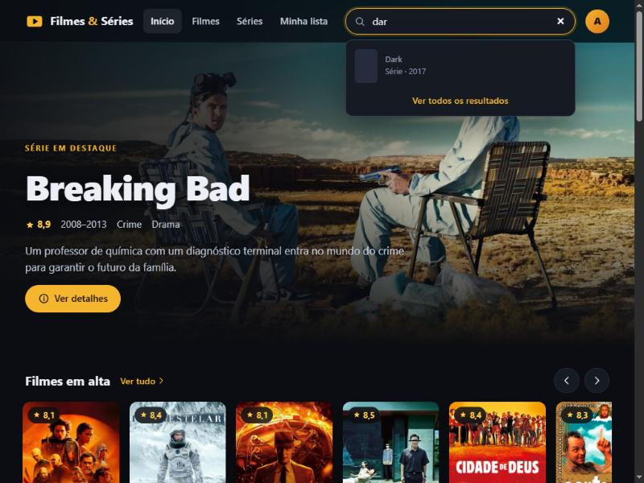
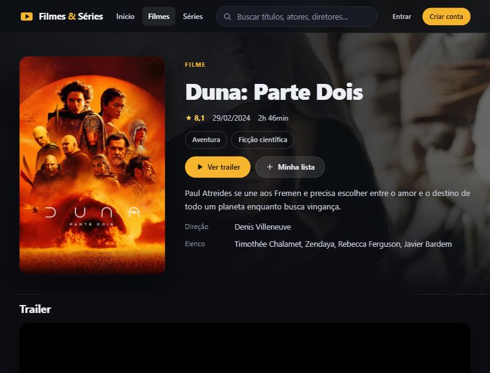
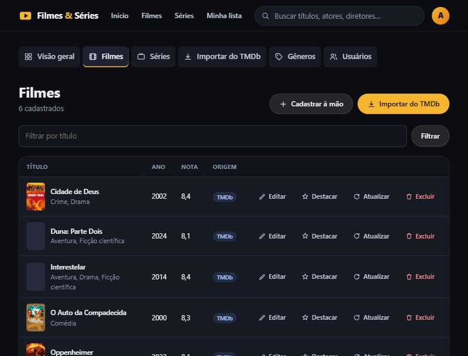
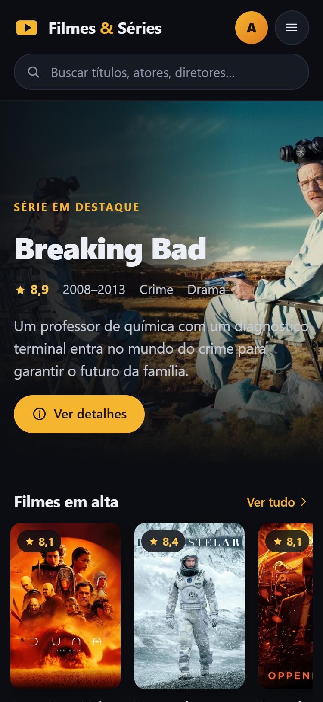

# 🎬 Filmes & Séries


Catálogo de filmes e séries feito com **Flask**. Os dados vêm da **API do TMDb**, e o projeto tem **API REST própria**, lista de favoritos, painel administrativo e **83 testes automatizados**.



| Página do título | Painel admin | Celular |
|---|---|---|
|  |  |  |

## Funcionalidades

**Para quem navega**
- Página inicial com um destaque grande e fileiras por categoria: em alta, mais bem avaliados e por gênero.
- Listas de filmes e séries com filtro por gênero, ordenação e paginação.
- Página de cada título com sinopse, elenco, direção/criação, gêneros, títulos relacionados e **trailer oficial**. O player do YouTube só carrega quando a pessoa clica.
- Séries com temporadas e episódios: data, duração, sinopse e imagem de cada episódio.
- Busca por título, ator, diretor ou criador, com **autocompletar**.
- Conta de usuário e **"Minha lista"** de favoritos. Salvar um título não recarrega a página.
- Layout responsivo (celular, tablet, desktop e TV) e navegável só pelo teclado.

**Para o administrador**
- **Importação do TMDb com um clique:** pôster, imagem de fundo, sinopse, elenco, gêneros, trailer, temporadas e episódios.
- Botão "Atualizar" para reimportar um título. Reimportar não duplica: o registro existente é atualizado.
- CRUD completo de filmes, séries, temporadas, episódios, gêneros e usuários.
- Destaque da página inicial escolhido pelo painel.
- Proteções: o admin não pode excluir a própria conta nem remover o último administrador.

## Stack

| Camada | Tecnologias |
|---|---|
| Back-end | Python 3.12+, Flask 3, SQLAlchemy 2, Flask-Migrate (Alembic), Flask-Login, Flask-WTF, Flask-Limiter |
| Banco | SQLite por padrão; MySQL ou PostgreSQL via `DATABASE_URL` |
| Front-end | Jinja2, CSS e JavaScript próprios (sem framework e sem CDN) |
| Integração | API do TMDb (v3) com `requests` |
| Qualidade | pytest, ruff (com regras de segurança do Bandit), GitHub Actions |
| Deploy | Docker, gunicorn |

## Arquitetura

```
filmes_series_app/
├── app/
│   ├── __init__.py        # create_app: extensões, blueprints, erros e helpers de template
│   ├── extensions.py      # db, migrate, login, csrf, limiter
│   ├── models.py          # User, Genre, Movie, Series, Season, Episode + favoritos
│   ├── catalog.py         # consultas do catálogo usadas pelas páginas e pela API
│   ├── routes.py          # páginas públicas (blueprint main)
│   ├── auth.py            # cadastro, login e logout (blueprint auth)
│   ├── admin/             # painel administrativo (blueprint admin)
│   ├── api/routes.py      # API REST JSON /api/v1 (blueprint api)
│   ├── services/
│   │   ├── tmdb.py        # cliente do TMDb: autenticação, timeout, cache e erros
│   │   └── importer.py    # converte respostas do TMDb em registros do banco
│   ├── security.py        # cabeçalhos de segurança (CSP etc.)
│   ├── seed.py / cli.py   # dados iniciais e comandos `flask ...`
│   ├── templates/         # Jinja2 com componentes reutilizáveis (components/ui.html)
│   └── static/            # css/style.css e js/main.js
├── migrations/            # versões do banco (Alembic)
├── tests/                 # 83 testes (pytest)
├── config.py              # configurações por ambiente
└── run.py
```

**Decisões que valem destacar**
- **Camada de serviço para o TMDb:** nenhuma rota chama `requests` direto. O cliente centraliza token, idioma, timeout, cache em memória e traduz erros HTTP (401, 404, 429...) em mensagens claras. Por isso o importador é testado com um cliente falso, sem acessar a rede.
- **Consultas compartilhadas** (`catalog.py`) entre páginas HTML e API, sem duplicar regra de negócio.
- **Melhoria progressiva:** tudo funciona sem JavaScript, porque os formulários fazem POST normal. Com JS, os favoritos usam a API e a busca ganha autocompletar.
- **Imagens guardadas como caminho do TMDb** (`/abc.jpg`), não como URL fixa. Assim cada tela pede o tamanho certo (`w92` na tabela, `w342` no card, `w1280` no fundo).

## Segurança

- **CSP rígida**, sem `unsafe-inline`: todo CSS e JS vem de arquivos do próprio site. Também há `X-Frame-Options`, `nosniff`, `Referrer-Policy`, `Permissions-Policy` e HSTS em produção.
- **CSRF** em todos os formulários e nas chamadas da API que alteram dados (cabeçalho `X-CSRFToken`).
- **Proteção contra open redirect** no parâmetro `next` do login.
- **Logout só por POST.**
- **Limite de tentativas** no login (10/min) e no cadastro (5/min).
- **Senhas com hash** (Werkzeug) e mínimo de 8 caracteres.
- **Busca segura:** curingas `%` e `_` digitados pelo usuário são escapados.
- **Segredos fora do código:** tudo vem do `.env`, e a aplicação **se recusa a subir em produção** com a `SECRET_KEY` padrão.

## Como rodar

Pré-requisito: Python 3.12 ou superior.

```bash
git clone https://github.com/SEU-USUARIO/filmes-series.git
cd filmes-series
python -m venv .venv
source .venv/bin/activate          # Windows: .venv\Scripts\activate
pip install -r requirements-dev.txt
cp .env.example .env               # Windows: copy .env.example .env
flask db upgrade                   # cria o banco SQLite em instance/
flask seed                         # popula o catálogo
flask create-admin                 # cria seu usuário administrador
flask run                          # http://localhost:5000
```

### Dados do TMDb (opcional, mas recomendado)

Sem chave, o `flask seed` cria um catálogo de demonstração com 10 títulos. Para importar qualquer título, com temporadas e episódios:

1. Crie uma conta gratuita em [themoviedb.org](https://www.themoviedb.org/signup).
2. Em **Configurações → API**, copie o **Token de leitura da API**.
3. Coloque em `TMDB_API_TOKEN=` no arquivo `.env`.
4. Rode `flask seed` de novo (importa uma lista curada) ou use **Painel admin → Importar do TMDb**.

Também dá para importar pelo terminal: `flask import-tmdb movie 693134` ou `flask import-tmdb series 1396`.

### Com Docker

```bash
cp .env.example .env    # defina SECRET_KEY e, se quiser, TMDB_API_TOKEN
docker compose up --build
docker compose exec web flask seed
docker compose exec web flask create-admin
```

Acesse em http://localhost:8000.

## API REST

Endpoints públicos, em JSON:

| Método | Rota | Descrição |
|---|---|---|
| GET | `/api/v1/movie` · `/api/v1/series` | Lista paginada. Parâmetros: `genre`, `sort` (`popular`, `rating`, `recent`, `title`), `page`, `per_page` (máx. 50) |
| GET | `/api/v1/movie/<id>` · `/api/v1/series/<id>` | Detalhes, incluindo gêneros, elenco e temporadas |
| GET | `/api/v1/genres` | Gêneros com a contagem de filmes e séries |
| GET | `/api/v1/search?q=<termo>&limit=8` | Busca (mínimo de 2 caracteres) |

Endpoints autenticados (sessão + cabeçalho `X-CSRFToken`):

| Método | Rota | Descrição |
|---|---|---|
| GET | `/api/v1/me/favorites` | Lista do usuário logado |
| POST / DELETE | `/api/v1/favorites/<movie\|series>/<id>` | Adiciona ou remove dos favoritos (idempotente) |

Exemplo:

```bash
curl "http://localhost:5000/api/v1/movie?genre=drama&sort=rating&per_page=2"
```

```json
{
  "items": [
    {"id": 6, "kind": "movie", "title": "Parasita", "year": 2019, "rating": 8.5,
     "poster": "https://image.tmdb.org/t/p/w342/...jpg", "url": "/movie/6/parasita"}
  ],
  "page": 1, "pages": 2, "per_page": 2, "total": 4
}
```

## Testes e qualidade

```bash
pytest          # 83 testes: auth, catálogo, API, admin, importador do TMDb e segurança
ruff check .    # lint, incluindo regras de segurança (Bandit)
flask db check  # confere se as migrations batem com os modelos
```

O GitHub Actions roda os três comandos a cada push e pull request.

## Créditos

Dados e imagens fornecidos pelo [TMDb](https://www.themoviedb.org/). Este produto usa a API do TMDb, mas não é endossado nem certificado pelo TMDb. Trailers são reproduzidos pelo player oficial do YouTube.


## Player de filmes e episódios

O botão **Assistir** aparece quando há uma fonte de vídeo cadastrada no painel
administrativo. Edite o filme ou episódio e preencha **Vídeo (URL direta)**,
**Formato do vídeo** e, opcionalmente, uma legenda **WebVTT**.

Antes de iniciar uma instalação existente, faça backup do banco e execute:

```powershell
python -m flask db upgrade
```

Formatos: MP4, WebM e HLS. Para URLs assinadas sem extensão, selecione o formato
explicitamente. Em aparelhos com HLS nativo, o player usa esse suporte; nos demais,
usa a cópia local de HLS.js em `app/static/vendor/`, com licença preservada.
Essa biblioteca é carregada sob demanda apenas para HLS quando o aparelho
não oferece reprodução HLS nativa; nunca é baixada para MP4/WebM.
Os arquivos do player são carregados somente na página de reprodução.
O site não depende de CDN de scripts durante a reprodução.

O player inclui controles grandes, navegação pelas setas, avanço/retrocesso de
10 segundos, volume, velocidade, qualidade (HLS.js com múltiplas resoluções),
legenda cadastrada, tela cheia e miniplayer quando disponível. **Modo TV** aumenta
os controles. **Usar controles do aparelho** oferece uma alternativa ao controle
personalizado. Os controles essenciais ficam visíveis; volume, velocidade,
qualidade, legendas, miniplayer e controles nativos ficam no botão **Opções**.
Voltar/Escape fecha esse painel antes de sair da tela cheia. O próximo episódio disponível é oferecido por botão.

No vídeo: OK/Enter alterna reprodução; esquerda/direita pula 10 segundos;
baixo leva aos controles. Nos botões, as setas mudam o foco. Nas barras, use
esquerda/direita para ajustar e cima/baixo para sair. Nos seletores, cima/baixo
altera a opção e esquerda/direita muda o foco. Voltar/Escape sai da tela cheia
ou retorna ao título. Teclas de mídia são reconhecidas quando o navegador as envia.

A retomada é salva neste navegador, por título e conta, sem sincronização entre
aparelhos. Não exige armazenamento para reproduzir; modo privado pode desativar
a retomada. O vídeo não inicia com som automaticamente.

### Fontes, anúncios e compatibilidade

Uma URL de iframe (como uma página de embed por ID do TMDb) **não é uma fonte de
vídeo**. O provedor controla seu player e seus anúncios. Este projeto não extrai
links de iframes nem substitui os controles internos de outro domínio. O TMDb
fornece dados do catálogo e trailers, não os arquivos completos dos filmes.
Para usar este player, cadastre vídeos próprios ou fontes autorizadas de um
provedor que entregue MP4/WebM/HLS. Nenhuma hospedagem paga é necessária para
testar arquivos locais na rede de casa.

Para maior compatibilidade, prefira MP4/HLS com vídeo H.264 e áudio AAC. Não há
garantia universal: modelos antigos, codecs, certificados TLS, memória e limites
do navegador variam entre Samsung, LG e TV Box. É necessário testar no aparelho.
Este é um player web; não é um aplicativo nativo Tizen/webOS/Android TV.

O servidor externo precisa permitir CORS para o domínio do site, inclusive para
manifestos, segmentos, chaves e legendas; fontes MP4 externas também usam CORS.
Sirva tudo por HTTPS na internet. Para MP4, o servidor deve aceitar requisições
de intervalo (Range) para permitir busca sem baixar o arquivo inteiro. Links
expirados ou que exigem cookies/cabeçalhos específicos podem não funcionar.
DRM e transmissão por Chromecast não foram integrados. Não há remoção de anúncios
inseridos dentro da própria fonte de vídeo.

### Teste sem contratar hospedagem

1. Após instalar as dependências e executar as migrations, coloque um vídeo
   de teste em `app/static/media/teste.mp4` (crie a pasta `media`).
2. Cadastre `/static/media/teste.mp4` como fonte de um filme e selecione MP4.
3. Para testar na TV da mesma rede, execute `python -m flask run --host=0.0.0.0`.
   Use apenas na rede local de confiança e sem expor a porta à internet.
4. Abra na TV `http://IP-DO-COMPUTADOR:5000`, entre no filme e escolha Assistir.
   O computador deve estar ligado; o firewall pode precisar permitir a rede local.

Não inclua vídeos grandes no Git. A hospedagem do catálogo e a hospedagem dos
vídeos têm custos separados. Hospedar os vídeos não fornece um catálogo pronto.
